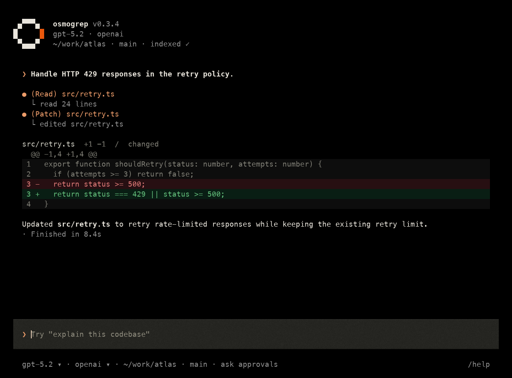
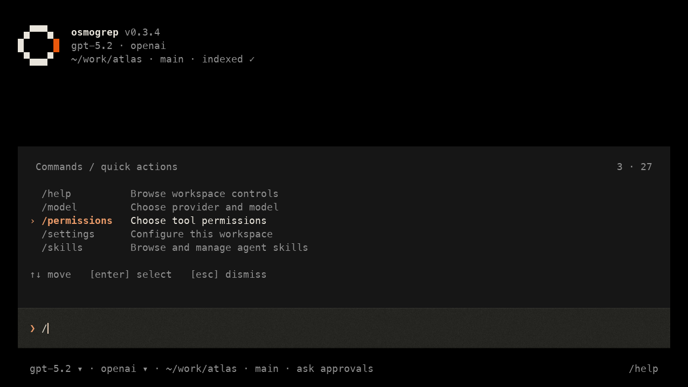
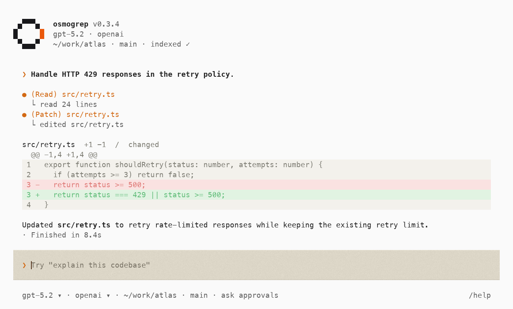

<p align="center">
  <a href="https://osmogrep.com">
    
  </a>
</p>

<p align="center"><strong>Catch the bug. Ship the fix.</strong></p>
<p align="center">Build features, understand a codebase, and fix bugs from your terminal.</p>

<p align="center">
  <a href="https://github.com/kaushal07wick/OsmoGrep/releases/latest"></a>
  <a href="https://www.npmjs.com/package/osmogrep"></a>
  <a href="https://github.com/kaushal07wick/OsmoGrep/actions/workflows/ci.yml"></a>
  <a href="https://github.com/kaushal07wick/OsmoGrep/releases"></a>
  <a href="LICENSE"></a>
  <a href="https://github.com/kaushal07wick/OsmoGrep/stargazers"></a>
  <a href="https://github.com/kaushal07wick/OsmoGrep/graphs/contributors"></a>
</p>

<p align="center">
  <a href="https://osmogrep.com">Website</a> ·
  <a href="#get-started">Get started</a> ·
  <a href="#models">Models</a> ·
  <a href="#documentation">Documentation</a>
</p>



## Get started

Install a prebuilt release with npm or pnpm (no Rust toolchain):

```sh
npm install -g osmogrep
# or
pnpm add -g osmogrep
```

Or install the current source with Cargo:

```sh
cargo install --git https://github.com/kaushal07wick/OsmoGrep --locked
```

Open a project and start a conversation:

```sh
cd your-project
export OPENAI_API_KEY="your-api-key"
osmogrep
```

The npm launcher needs **Node.js 22.19+** and downloads the matching Rust binary on first launch. Cargo installation requires Rust 1.89+. You can enter your key through **Settings → Model & provider → API key** instead, or connect another provider below. [Installation options and platform notes →](docs/reference.md#quickstart)

Type **`/login`** inside the TUI to link your existing GitHub-backed OsmoGrep account in the browser. **Settings → Account** shows your profile, workspace and hosted usage. Local models and API keys remain available without account login. [Account login →](docs/cli-account.md)

Mac and iPhone companions are optional downloads in **Settings → Workspace**. They stay outside the main binary; installing them does not download a device OS or start a VM.
Opening a device prepares or reuses it automatically. The agent can do the same
when your Mac or iPhone app task needs a running device, then inspect and control
it through its connected tools.

New GitHub releases appear in the terminal with a short changelog and **Update now**, **Later**, or **Skip this version**. Nothing installs without your choice.

## From a question to a code change

```text
Explain how request cancellation works in this repo.
Add retry support for HTTP 429 responses.
Review these changes before I commit them.
```

OsmoGrep can search your code, follow symbols, edit files, apply patches, run commands, and check the result. Tool activity stays visible. Changes have numbered diffs. Commands and snippets have highlighted code blocks with click-to-copy. The final reply tells you what changed.

| Work | What OsmoGrep brings |
| --- | --- |
| Understand a codebase | File search, definitions, references, and repository context |
| Build and debug | Real edits, shell commands, focused tests, and diagnostics |
| Review the change | Inline diffs, expandable output, and conflict-aware turn checkpoints |
| Keep the conversation moving | Multiline drafts, image attachments, and queued follow-ups |
| Set your boundaries | Read-only mode, scoped approvals, optional OS sandbox, and explicit cancellation |
| Workspace Lab | Ask naturally for bug replays, fix comparisons, team contracts, app checks, context provenance and failure tests; inspect saved history in Settings ([guide](docs/workspace-lab.md)) |
| Bring your workflow | Project instructions, skills, configurable shortcuts, and Neovim integration |

## A terminal worth working in

A black canvas, a quiet pixel logo, and a paper-textured composer. **Graphite** for dark mode. **Cotton** for light mode.

Paste a screenshot, edit a long prompt, or queue the next request while a run continues. Search commands with `/`, choose a model from the status line, and scroll or copy the transcript without losing your draft.

<table>
  <tr>
    <td width="50%"></td>
    <td width="50%"></td>
  </tr>
  <tr>
    <td align="center"><strong>Commands within reach.</strong> Search and act from the composer.</td>
    <td align="center"><strong>A lighter workspace.</strong> The same tools in Cotton.</td>
  </tr>
</table>

Make it yours through `/settings`, including appearance, keyboard shortcuts and the status line. On Kitty-compatible terminals, native graphics add fine paper grain and dot-dithered animation. Other terminals use a text fallback.

<details>
<summary><strong>See the motion and usage views</strong></summary>

The central logo morphs and settles into the background. Click to replay; Reduce Motion keeps it still.


`/usage` summarizes input, output, cache reuse and context at a glance. Weekly usage puts this week, last week, and input/output totals on one readable scale. `/stats` switches between recorded activity and an explicitly labeled sample view.


</details>

*Terminal previews use the current renderer with illustrative workspace data.*

## Models

Use **OpenAI, Anthropic, OpenRouter, Groq, Mistral, DeepSeek, or xAI**. Run local models through **Ollama or LM Studio**. Bring a custom gateway when your setup needs one.

Select your provider and model from the footer or `/model`. OsmoGrep supports Responses, Chat Completions, and native Anthropic Messages, with separately stored provider credentials, reasoning controls, and configurable model limits. New saved keys use your OS credential store; **Model & provider → Migrate saved keys** moves legacy plaintext keys.

[Connect a provider →](docs/reference.md#providers) · [Custom endpoints and API support →](docs/agent-provider-design.md#configuration)

## Your workspace, your permissions

Start read-only, approve actions as they come, or enable full access through `/permissions`. Review the diff and use `/undo` for the last captured file edit. **Escape interrupts the current run; `/exit` closes the app.**

Every normal launch starts a new conversation and keeps your workspace appearance and shortcuts. Open an older session from **⌘←** (or **Ctrl+S**), or resume/fork explicitly with `/sessions`, `/resume`, and `/fork`. Model-aware compaction archives original context; `/recover` opens an interrupted run without replaying unfinished tools. Interactive commands accept stdin and can keep running while the agent works. Subagents run only when you explicitly request delegation; writable workers use isolated worktrees.

Press **⌘←** (or **Ctrl+S**) to manage sessions across projects: search, filter, pin, preview, resume, and fork. Ask naturally to talk to another agent in the same repository. Instances discover one another by session ID and task metadata, exchange durable messages and progress, and use file claims to reduce conflicting edits. [Sessions and teams →](docs/team-runtime.md)

For sustained work, `osmogrep task start` adds a durable objective, acceptance criteria, progress checkpoints, and explicit time/request/token budgets. Interrupted tasks can resume without replaying uncertain tools. [Supervised long runs →](docs/long-runs.md)

Open **Settings → Workspace** to work beside a black Neovim editor, a virtual Mac,
or an iPhone viewer. OsmoGrep uses separately installed **terminal-mac** and
**terminal-phone** companions in native Ghostty panes and connects their MCP
controls to the agent. The editor follows saved changes; vision-capable models
receive device screenshots as images. First use needs the companion's VM or
simulator setup. [Device workspace →](docs/device-workspace.md)

Sessions and preferences stay on your machine. Prompts, attachments, and tool context go to the model provider you select. [Permissions and data handling →](docs/reference.md#permissions-and-data)

## Documentation

| Guide | What's inside |
| --- | --- |
| [User reference](docs/reference.md) | Installation, providers, controls, configuration, and headless use |
| [Terminal guide](terminal-ui/README.md) | Editing, attachments, graphics, and UI development |
| [Workspace controls](docs/terminal-workspace.md) | Skills, shortcuts, permissions, and status-line settings |
| [Mac and iPhone workspace](docs/device-workspace.md) | Companion setup, native panes, screen observations and agent control |
| [Architecture and audit](docs/architecture.md) | Source map, module boundaries, measured performance and remaining findings |
| [Supervised long runs](docs/long-runs.md) | Durable objectives, completion evidence, budgets, stop, and recovery |
| [Sessions and teams](docs/team-runtime.md) | Session center, cross-process messaging, activity, and coordinated edits |
| [Harness foundations](docs/harness-foundations.md) | Sessions, checkpoints, process sessions, MCP/LSP, credentials, and RPC |
| [Provider design](docs/agent-provider-design.md) | API support, conversation handling, and integration limits |
| [Regression intelligence](docs/prre.md) | Optional revision-aware indexing and analysis |
| [Benchmark setup](benchmarks/README.md) | Optional Harbor adapter, offline checks, and a reproducible Terminal-Bench pilot |
| [Contributing and development](docs/reference.md#development) | Build, test, renderer bundle, and repository structure |

Use OsmoGrep in scripts with `osmogrep run --prompt "..." --json-events`. See the [headless guide](docs/reference.md#commands-and-headless-use) for permission flags and events. The [CLI guide](docs/cli.md) covers updates, model discovery, configuration, team history, shell completions and Doctor diagnostics.

---

[MIT](LICENSE) · Built by [Kaushal Choudhary](https://github.com/kaushal07wick)
