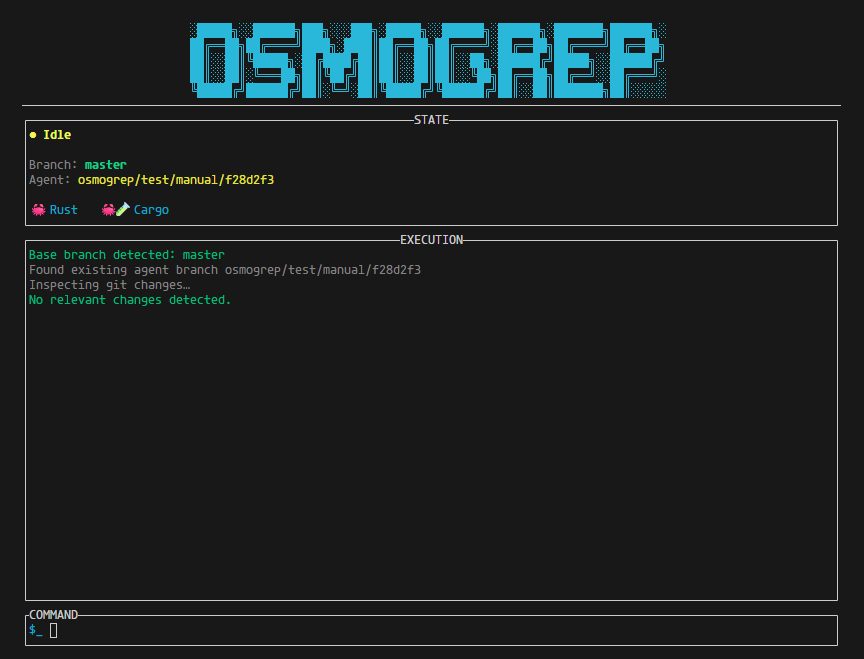
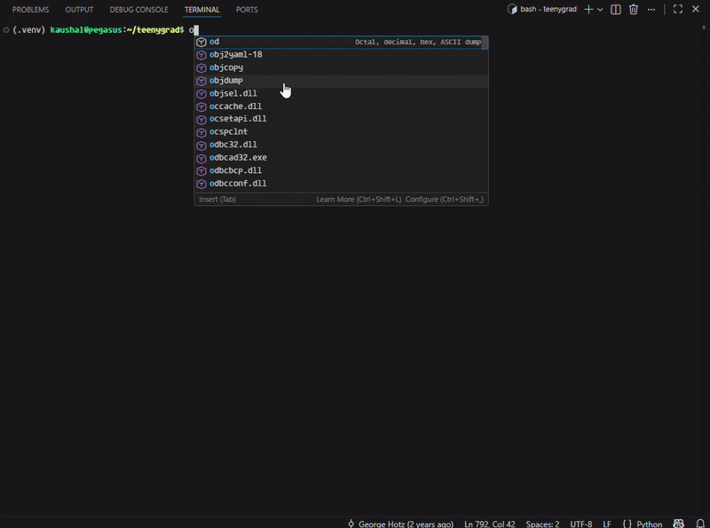

<p align="center">
  
</p>

<p align="center">
  <strong>A terminal coding agent that has to prove it worked.</strong>
</p>

<p align="center">
  <a href="https://crates.io/crates/osmogrep"></a>
  <a href="https://github.com/kaushal07wick/OsmoGrep/actions/workflows/ci.yml"></a>
  
  
</p>

---

Most coding agents write code and tell you it's done. Osmogrep runs the code, keeps a
ledger of what actually passed, and refuses to call a task finished on evidence it
doesn't have.

It is a single Rust binary that opens a TUI in your git repository, drives an
OpenAI-compatible model through an explicit toolset, and wraps that loop in machinery
built for one purpose: catching bugs that only show up at runtime, then fixing them and
proving the fix.

<p align="center">
  
</p>

## Why this isn't just another coding agent

### 1. A verification ledger, not a vibe check

Every shell command the agent runs is classified. `cargo test`, `pytest`,
`go test`, `npm run lint`, `make build`, `cargo clippy`, `cargo nextest run` and friends
are recognised — including through `env VAR=x`, `time`, `&&` chains, and
`uv run pytest`-style wrappers — and appended to
`.context/osmogrep-verification.jsonl` with their exit code, scope (targeted vs. full),
and output summary.

Every file the agent edits is appended to the same ledger. The result is a live status:

| Status | Meaning |
| --- | --- |
| `passed` | The last relevant command exited 0 and nothing has changed since |
| `failed` | The last relevant command exited non-zero |
| `stale` | Code changed after the last passing run — the green is no longer valid |
| `unverified` | Nothing has been run yet |

Doc-only edits (`.md`, `LICENSE`, `CHANGELOG`, …) do **not** invalidate a passing run.
Touching `src/lib.rs` does. Check it any time with `/verify`.

### 2. It gets stopped when it tries to hand back unverified work

When the model tries to finish a run with a `stale` or `failed` ledger, Osmogrep
intercepts the stop and injects a nudge listing the exact paths that need verification,
the last evidence it has, and an instruction to run the tests, read the failure, and fix
the root cause. This fires at most twice per run, so the agent either produces real
evidence or explicitly states the blocker — it never quietly declares victory.

### 3. It notices when it's stuck in a loop

A tool-loop guard hashes every `(tool, arguments)` pair and its result. Two identical
failures, three failures of the same tool, or two identical results from a read-only
tool trigger a warning fed straight back into the conversation: *stop retrying
unchanged, change strategy.* This is what stops the classic 40-iteration
`cargo build` → same error → `cargo build` spiral.

### 4. It runs and parses tests as first-class data

`run_tests` auto-detects cargo / pytest / jest / go, runs with a cancellable timeout,
and returns structured `passed` / `failed` counts, duration, timeout and cancellation
flags — not just a wall of stdout. `diagnostics` runs the project's lint/check command
and parses `file:line:col: message` into structured issues the model can act on
directly.

### 5. Every change is reviewable and reversible

Each edit is captured as a before/after snapshot pushed onto a session undo stack.
`/diff` shows everything changed this session; `/undo` reverts the last change. When a
run ends, unreviewed changes are automatically queued as a background **review** job
that runs an independent code-review sub-agent against the diff looking for regressions,
edge cases, and missing tests. With `/autofix on`, a **test** job is queued alongside it.

### 6. Parallel isolated agents when the task is genuinely big

`worktree_swarm` creates four real `git worktree` checkouts on their own branches and
runs four headless Osmogrep subagents in parallel — **explore**, **edit**, **test**,
**review** — each required to run verification in its own worktree before reporting
back. Nothing touches your working tree until you integrate the results.

### 7. It reads the repo structurally, not just by grep

A tree-sitter indexer (Rust + Python) builds `.context/context.json`: files, symbols,
line spans, and a call graph with `calls` / `called_by` edges, refreshed incrementally
as files change. `find_definition` and `find_references` sit on top of it.

## Install

```bash
# from crates.io
cargo install osmogrep

# or latest from GitHub
curl -fsSL https://raw.githubusercontent.com/kaushal07wick/osmogrep/master/install.sh | sh
```

Verify the install:

```bash
osmogrep doctor
```

## Quickstart

```bash
cd your-repo
export OPENAI_API_KEY=sk-...   # or run osmogrep and use /key
osmogrep
```

Then talk to it:

```
> the CSV importer crashes on empty rows, find it and fix it
> add tests for the retry path in src/http.rs
> why is test_parse_dates flaky?
```

Osmogrep will read files, run the code, read the failure, patch the root cause, re-run,
and only then summarize — with the commands it actually ran.

The terminal presentation runs in TypeScript when Node.js 22.19+ is available,
with a compact header, full-width transcript, startup animation and bottom
composer. Rust retains the existing agent, tools, permissions and commands.
Missing Node or a renderer failure restores the native Rust UI;
`OSMOGREP_UI=native osmogrep` selects it explicitly.

The composer supports multiline drafts, Shift+arrow selection, Ctrl+C/X/V
copy/cut/paste and image attachments with thumbnails on supported terminals.
Drag in an image path, or use Ctrl+V for a copied image on macOS.
See the [terminal UI and composer guide](terminal-ui/README.md) for shortcuts,
image limits and development instructions.

Headless, for CI or scripts:

```bash
osmogrep run --prompt "fix the failing tests and explain what broke" --json-events
```

Newline-delimited JSON events on stdout, with API keys and secret-looking strings masked.

## Toolset

The agent acts only through these tools. Every call is logged to a per-run JSONL ledger
under `.context/osmogrep-runs/`.

| Tool | What it does |
| --- | --- |
| `run_shell` | Run a shell command; stdout, stderr, exit code (guarded, timeout, cancellable) |
| `run_tests` | Detect and run the project's tests; structured pass/fail counts |
| `diagnostics` | Run lint/check and parse `file:line:col` issues |
| `read_file` | Read with offset/limit and continuation offsets |
| `write_file` / `edit_file` | Create or replace file content |
| `patch` | Apply a unified diff or begin/end patch |
| `notebook_edit` | Edit a Jupyter cell's source |
| `search` / `regex_search` / `glob_files` / `list_dir` | Find things |
| `find_definition` / `find_references` | Symbol-level navigation via the code index |
| `git_diff` / `git_log` / `git_commit` | Repository history and staging |
| `update_plan` | Durable multi-step plan at `.context/osmogrep-plan.json` |
| `web_search` / `web_fetch` | Look things up online |
| `dynamic_workflow` | Bounded fan-out research/audit workflow with a resumable ledger |
| `worktree_swarm` | Four isolated worktree subagents: explore / edit / test / review |
| `mcp_call` | Call a configured MCP server |

**Tool scoping.** Osmogrep doesn't hand the model all 23 tools on every turn. It derives
a scope from your prompt: web tools appear when you mention URLs or current docs,
`git_commit` when you mention commits or PRs, `worktree_swarm` and `dynamic_workflow`
for audits, parallel work, or a prompt ending in `ultracode`. Smaller toolset, better
tool choice.

**Parallel execution.** Consecutive read-only tool calls in a single model turn are
detected and executed concurrently on scoped threads; anything that mutates state runs
serially.

**Output budgeting.** Tool results over ~100k characters are written to
`.context/osmogrep-results/` and replaced in-context with a preview plus the file path,
so one enormous log can't blow up the conversation.

## Safety

- **Permission profiles** — `read-only` (mutating tools removed from the schema
  entirely), `workspace-auto` (default), `full-access`. Set with `/profile` or
  `--permission-profile`.
- **Approval prompts** — `run_shell`, `write_file`, and `edit_file` prompt before
  executing unless `/approve` is on.
- **Shell blocklist** — `rm -rf /`, `rm -rf ~`, `git reset --hard`, `git clean -fdx`,
  `mkfs`, `dd of=/dev/…`, fork bombs, recursive chmod/chown on `/`, and host power
  commands are refused before they run. Override with
  `OSMOGREP_ALLOW_BLOCKED_SHELL=1` if you know what you're doing.
- **Undo stack** — `/undo` reverts the last agent file change; `/diff` shows the whole
  session.
- **Timeouts and cancellation** — every child process runs under a timeout and is killed
  on `Esc`.
- **Secret masking** — headless JSON events mask API keys and secret-shaped strings.

## Commands

### CLI

| Command | Description |
| --- | --- |
| `osmogrep` | Open the TUI in the current repository |
| `osmogrep <session-name>` | Open the TUI and name/rename the session |
| `osmogrep --session <name>` | Same, as a flag |
| `osmogrep run --prompt "..."` | Run the agent headlessly |
| `osmogrep run --prompt-file p.md` | Same, prompt from a file |
| `osmogrep sessions` | List saved local sessions |
| `osmogrep doctor` | Install/config/session diagnostics |
| `osmogrep triage ...` | GitHub PR/issue triage (see below) |
| `osmogrep version` | Print the installed version |
| `osmogrep uninstall [--yes] [--dry-run]` | Remove the current binary |

`run` flags: `--repo-root`, `--prompt`, `--prompt-file`, `--json-events`,
`--permission-profile <read-only\|workspace-auto\|full-access>`, `--auto-approve`.

Optional regression intelligence adds `index`, `context`, `predict`, and
`intelligence-mcp`. It provides a revision-aware SQLite graph, deterministic
runtime screening and declared resource-capacity interaction hypotheses. See
[usage, architecture and integration limits](docs/prre.md) and the
[implementation log](docs/prre-implementation.md). Hosted verification and live
GitHub delivery remain integration-pending; normal coding does not require it.

### Slash commands

| Command | Description |
| --- | --- |
| `/help` | Show available commands |
| `/status` · `/usage` · `/metrics` | Session, run, model, repo status; tokens; queue metrics |
| `/verify` | Verification status, last evidence, stale paths |
| `/test [target]` | Run auto-detected tests, optionally targeted |
| `/diff` · `/undo` | Session changes; revert the last one |
| `/plan` · `/plan add` · `/plan done` · `/plan clear` · `/plan mode` | Durable plan; `mode` is read-only planning |
| `/profile [read-only\|workspace-auto\|full-access]` | Show or set permission profile |
| `/approve` | Toggle dangerous-tool auto-approve |
| `/steer <text>` | Persistent instruction injected into runs (live-steers a running agent) |
| `/jobs` · `/autofix on\|off` | Background jobs; auto-queue tests after each run |
| `/swarm <task>` | Fan out explore/edit/test/review sub-agents |
| `/model [provider model [base_url]]` · `/providers` · `/account` · `/key` | Model and credentials |
| `/compact` · `/clear` · `/new` | Compress context; clear logs; fresh conversation |
| `/triage [flags]` · `/gh [status\|prs\|issues\|triage]` | GitHub workflows |
| `/mcp` | MCP status and servers |
| `/voice [on\|off]` | Live voice input |
| `/theme` · `/color` · `/type` | Dark/light, accent colour, UI density |
| `/copy [all]` · `/rename <name>` | Copy last response or transcript; rename session |
| `/nv [toggle\|help]` | Neovim + Osmogrep split in tmux (auto-bootstraps tmux) |
| `/quit` · `/q` | Stop the running agent |
| `/exit` | Exit OsmoGrep |

During a run, `Esc` cancels the agent rather than exiting the app.

## Configuration

### Repository instructions

Osmogrep reads `.osmogrep.md`, `AGENTS.md`, `CLAUDE.md`, and `.cursorrules` from the
repo root and appends them to the system prompt (32 KB budget, in that order). It also
snapshots detected manifests and likely verify commands (`cargo test`, `pytest -q`,
`pnpm run lint`, `make check`, …) into the prompt at run start.

### `~/.config/osmogrep/config.toml`

```toml
[hooks]
pre_shell = "echo running {cmd}"
pre_edit  = "echo editing {path}"
post_edit = "cargo check -q"

[mcp]
enabled = true
default_server = "docs"

[mcp.servers.docs]
cmd = "node /path/to/your-mcp-bridge.js"
timeout_ms = 30000
```

`mcp_call` passes `OSMOGREP_MCP_SERVER`, `OSMOGREP_MCP_METHOD`, and
`OSMOGREP_MCP_ARGS` (JSON) to the server command.

Sessions, undo checkpoints, and conversation state persist per-repo under
`~/.config/osmogrep/sessions/`.

### Environment variables

| Variable | Purpose |
| --- | --- |
| `OPENAI_API_KEY` (or `GROQ_API_KEY`, `MISTRAL_API_KEY`, `OLLAMA_API_KEY`) | Provider credentials |
| `OSMOGREP_PROVIDER` · `OSMOGREP_MODEL` · `OSMOGREP_BASE_URL` | Override model config |
| `OSMOGREP_REASONING_EFFORT` | Reasoning effort for models that support it |
| `OSMOGREP_MAX_ITERATIONS` | Agent loop cap |
| `OSMOGREP_TEST_TIMEOUT_SECS` (300) · `OSMOGREP_SHELL_TIMEOUT_SECS` · `OSMOGREP_DIAGNOSTICS_TIMEOUT_SECS` · `OSMOGREP_GIT_TIMEOUT_SECS` · `OSMOGREP_PATCH_TIMEOUT_SECS` | Per-tool timeouts |
| `OSMOGREP_TOOL_RESULT_LIMIT` (100000) · `OSMOGREP_TOOL_PREVIEW_LIMIT` (1500) | Output budgeting thresholds |
| `OSMOGREP_WORKTREE_DIR` · `OSMOGREP_WORKTREE_AGENT_TIMEOUT_SECS` (900) | Worktree swarm |
| `OSMOGREP_ALLOW_BLOCKED_SHELL` | Disable the shell blocklist |
| `OSMOGREP_NO_STREAM` · `OSMOGREP_MOUSE` · `OSMOGREP_CLIPBOARD_OSC52` | UI/transport behaviour |
| `OSMOGREP_DISABLE_UPDATE_CHECK` | Skip the update check on startup |

## Models

Any OpenAI-compatible `/responses` endpoint works. Built-in base URLs for `openai`,
`groq`, and `ollama` (`http://127.0.0.1:11434/v1`); anything else via `--base_url`:

```
/model openai gpt-5
/model ollama qwen2.5-coder:14b
/model custom my-model https://my-gateway.internal/v1
```

Streaming is used where the provider supports it, with automatic fallback to blocking
requests and retries.

## GitHub triage

Rank pull requests, detect duplicates via lexical + semantic token scoring, and flag
scope drift against a `VISION.md`:

```bash
osmogrep triage \
  --repo owner/repo \
  --state open \
  --limit 3000 \
  --deep-review-all \
  --incremental \
  --state-file .context/triage-state-owner_repo.json \
  --vision ./VISION.md \
  --out triage-report.json
```

Apply labels and comments back to GitHub:

```bash
osmogrep triage --repo owner/repo --state open --incremental \
  --vision ./VISION.md --comment-actions --apply-actions --action-limit 100
```

`GITHUB_TOKEN` is recommended for higher API limits. `/gh triage` inside the TUI uses
high-volume defaults (`--state open --limit 3000 --deep-review-all --incremental`) and
writes `.context/triage-report-<owner_repo>.json` plus a markdown brief.

## Voice input

Osmogrep can stream live transcriptions into the input box via a vLLM realtime endpoint.
Requires a GPU host running vLLM, a browser mic (iPhone works), and an HTTPS tunnel —
iOS requires HTTPS for `getUserMedia`.

```bash
vllm serve mistralai/Voxtral-Mini-4B-Realtime-2602 --enable-realtime --host 0.0.0.0 --port 8000
```

```bash
VLLM_REALTIME_PROXY_LISTEN=0.0.0.0:7001 \
VLLM_REALTIME_URL=ws://127.0.0.1:8000/v1/realtime \
VLLM_REALTIME_MODEL=mistralai/Voxtral-Mini-4B-Realtime-2602 \
VLLM_REALTIME_SILENCE_MS=1200 \
osmogrep
```

Osmogrep opens a websocket proxy on `7001` and forwards to vLLM. Because iOS requires
HTTPS for `getUserMedia`, run the bundled reverse proxy — it serves the mic page on
`8080` and proxies `/v1/realtime` to `7001`:

```bash
MIC_HTML=/path/to/mic.html node tools/ws_reverse_proxy.js
ngrok http 8080
```

Open the HTTPS tunnel URL on your phone and speak. Live transcription appears above the
input box; final sentences land in it — press Enter to send.

## What Osmogrep writes to your repo

Everything lives under `.context/` — safe to gitignore:

```
.context/
├── context.json                    # tree-sitter code index + call graph
├── osmogrep-verification.jsonl     # verification evidence ledger
├── osmogrep-plan.json              # durable multi-step plan
├── osmogrep-runs/*.jsonl           # per-run tool/permission/status ledger
├── osmogrep-results/*.txt          # oversized tool outputs
└── osmogrep-workflows/*.json       # dynamic workflow ledgers
```

## Development

```bash
git clone https://github.com/kaushal07wick/OsmoGrep
cd OsmoGrep
cargo test
cargo clippy --all-targets -- -D warnings
cargo run
```

CI runs the test suite on Linux, macOS, and Windows.

Layout:

| Path | Role |
| --- | --- |
| `src/agent.rs` | Model loop, streaming, tool dispatch, event emission |
| `src/tools/` | Tool implementations and scoping/registry |
| `src/verification.rs` · `src/verify_stop.rs` | Evidence ledger and stop-guard |
| `src/tool_guard.rs` · `src/shell_guard.rs` · `src/tool_budget.rs` | Loop, shell, and output guards |
| `src/test_harness.rs` | Framework detection and result parsing |
| `src/worktree.rs` | Isolated worktree subagents |
| `src/context/indexer.rs` | tree-sitter index and call graph |
| `src/triage.rs` | GitHub PR/issue triage |
| `src/ui/` | TypeScript presentation bridge and native ratatui fallback |
| `terminal-ui/` | TypeScript renderer, animation, composer layout and UI tests |

## Contributing

Issues and pull requests welcome. Please keep changes focused, add a test for
non-trivial logic, and make sure `cargo test` and `cargo clippy` are clean before
opening a PR.

## License

[MIT](LICENSE).
