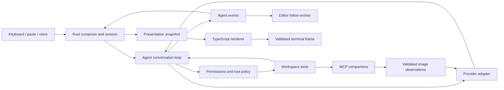

# Repository architecture

OsmoGrep is one Rust application with a bundled TypeScript presentation process.
Rust owns input, permissions, conversation history, model requests, tools, and
storage. The renderer owns layout and terminal graphics. Optional Swift device
companions run as separate applications; their MCP servers expose observation
and input to the Rust tool loop.

```text
src/
  main.rs                  CLI dispatch, interactive lifecycle, event handling
  state.rs                 Session, transcript, composer and UI state
  commands.rs              Interactive commands and background actions
  agent.rs                 Conversation loop, tool dispatch, permission requests
  prompts/agent.md         Base agent instructions
  provider.rs              Responses / Chat Completions / Anthropic transport
  provider_tests.rs        Wire-format, replay and cancellation contracts
  model_options.rs         Reasoning controls and model capabilities
  compaction.rs            Bounded context handoff and recoverable history
  tools/                   File, search, shell, Git, MCP and other tool adapters
  tool_guard.rs            Repeated-call and no-progress checks
  tool_budget.rs           Tool text budgets and native image observations
  file_guard.rs            Workspace paths, read receipts and guarded replacement
  process_runner.rs        Process groups, output bounds, cancellation
  command_sessions.rs      Long-running interactive command sessions
  approval_rules.rs        Approval matching
  shell_guard.rs           Shell action policy
  sandbox.rs               Optional platform enforcement
  credentials.rs, auth.rs  Credential storage and authentication
  storage.rs               Atomic writes and shared file locking
  persistence.rs           Saved sessions and configuration
  preferences.rs           Workspace appearance and UI preferences
  team.rs                  Cross-process discovery, messages, activity, file claims
  subagents.rs, worktree.rs Explicit delegation and isolated writable workers
  harness.rs               Run event ledger
  long_runs.rs             Budgeted task supervision and recovery
  verification.rs          Evidence accounting
  verify_stop.rs           Optional verification completion policy
  editor.rs, editor.lua    Private tmux editor workspace and black Neovim UI
  editor/follow.rs         Background bridge for active files and saved changes
  workspace/               Native device panes and companion resolution
  mcp.rs, mcp/local.rs     MCP transport and repository-scoped device connections
  ui/                      Rust event/render bridge and native fallback interface
  usage.rs, updater.rs     Usage ledger and release installation
  context/                 Python/Rust index and revision-aware graph storage
  intelligence/            Optional regression analysis and experiment workflows
  triage.rs                Optional GitHub triage workflow
  voice.rs                 Optional voice input

terminal-ui/
  src/renderer.ts          Frame layout
  src/code.ts              Code blocks, copy targets and bounded formatting cache
  src/activity.ts          Approved working-orb frames
  src/{intro,paper,...}.ts Brand graphics, material and panels
  src/*.test.ts            Rendering, geometry, text and interaction contracts
  bundle/renderer.mjs     Generated renderer embedded in the Rust binary
  scripts/                Reproducible acceptance checks and preview tools

benchmarks/harbor/         Optional external task adapter and pinned pilot setup
docs/                     Product guides, architecture and validation evidence
third_party/              Adapted code attribution and upstream provenance
.github/workflows/        Cross-platform CI and release packaging
```

The source count is approximately 41,000 Rust lines and 1,800 TypeScript lines,
including in-file tests and excluding the generated bundle. This is a source map,
not a claim that every module has an independent package boundary.

## Main request path



Canonical history keeps tool calls paired with their results. Provider-specific
replay preserves native reasoning blocks where required. Image tool results stay
typed in canonical history: Responses receives image output parts, Anthropic
receives image blocks inside tool results, and Chat Completions receives image
observations after all results in the parallel batch. These observations do not
replace the original user request in persisted history.

## Boundaries improved in this change

- Shared atomic writes and configuration locks now live in `storage.rs`, without
  depending on UI state. Model/key saves merge only their owned fields into the
  current configuration.
- Editor following has one bounded wake queue and a background worker. Device
  launch and its transient state live in `workspace/`.
- Ephemeral device MCP entries live in `mcp/local.rs`, keyed by canonical project
  root. Phone target binding happens before transport dispatch.
- The TypeScript formatting cache is bounded by eight entries and approximately
  2 MiB of string storage. Width, theme, accent, source text and copy feedback
  invalidate it.

## Remaining restructuring, in dependency order

These are concrete remaining jobs, not completed refactors:

1. Extract the interactive event reducer from `main.rs` into `runtime/`. Keep CLI
   dispatch and lifecycle assembly in `main.rs`; preserve event ordering and
   cancellation tests before changing presentation scheduling.
2. Separate provider configuration/discovery and the tool executor from
   `agent.rs`. Leave the conversation loop responsible for advancing turns and
   assembling canonical history. Keep the existing provider wire adapter.
3. Split user commands from workflow/job dispatch in `commands.rs`. Keep one
   command registry so visible controls, help and typed aliases cannot diverge.
4. Replace repeated full snapshots with revisioned transcript/diff updates and
   asynchronous presentation. Use the current snapshot as a compatibility path
   until terminal acceptance checks cover both.
5. Move optional triage and regression workflows behind their existing command
   boundaries before deciding whether Cargo features or separate crates reduce
   real build/install cost. No new crate or trait hierarchy is needed today.

The current release keeps one Cargo package, adds no dependency, and retains the
native renderer fallback. See the [audit](architecture-audit.md) for correctness
and performance limits that still need work.
