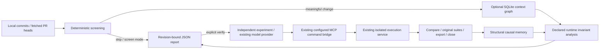

# Optional regression intelligence

This is a locally testable intelligence layer for the existing OsmoGrep agent.
Hosted integration is pending. A controlled regression and repair have now been
verified in real isolated VMs through the existing OsmoGrep MCP tools; see
[runtime evidence](prre-runtime-validation.json). The master engineering definition
of done is **not yet met**: the new Rust normalized verification bridge and live
GitHub delivery remain unvalidated.
The detailed audit and executed checks are in [prre-implementation.md](prre-implementation.md).

## Boundaries

Normal CLI/TUI startup does not open the intelligence database. The existing
agent, provider configuration, working-tree index, tools, test harness and local
verification ledger keep their roles. Graph queries are optional, read-only agent
tools. An unavailable or corrupt graph returns a query error without disabling
the existing tools.



The cloud worker, console, E2B implementation and GitHub App described in the
master prompt are absent from this checkout. This change does not recreate them.
JSON reports and stdio MCP provide the integration surface; wiring them into
those applications requires their source and contracts.

## Commands

```sh
osmogrep index --commit HEAD
osmogrep context status
osmogrep context impact --commit HEAD --symbol handle_request
osmogrep context history db
osmogrep context observe observation.json

osmogrep predict --base HEAD^ --commit HEAD --mode screen
osmogrep predict --base main --commit feature --mode balanced
osmogrep predict --left pr-a --right pr-b
osmogrep predict --prs 142,147
osmogrep predict report <run-id>

osmogrep predict --base main --commit HEAD --verify \
  --experiment experiment.json --sandbox verification
osmogrep predict --base main --commit HEAD --verify \
  --generate-experiment --sandbox verification

osmogrep intelligence-mcp --repo-root /authorized/repository
```

PR numbers resolve already fetched `refs/pull/<n>/head` or
`refs/remotes/origin/pr/<n>`. They do not trigger authentication, fetches or GitHub
comments. Use your existing authorized Git workflow to fetch missing heads.

`--policy policy.json` accepts the fields of `intelligence::predict::Policy`.
Defaults when explicitly invoked are balanced mode, three hypotheses, one
experiment, a 120-second experiment deadline, one model call, 6,000 model tokens,
200 changed files, and 200 graph nodes. `off` and `screen` prevent experiments.
`deep` and `manual` currently use the same deterministic rules and configured
limits as balanced; they do not imply additional reasoning. Unknown policy fields
are errors. No automatic scheduler or merge blocking is enabled.

Deterministic analysis makes no model requests. `--generate-experiment` explicitly
uses the existing configured provider, reserves a durable model-call allowance,
bounds prompt bytes/output tokens, and records provider-reported usage when
available. A malformed, over-budget or provenance-changing response cannot run.
The tokenizer's exact total remains provider-reported; the local byte budget is
a conservative screening bound, not an independently measured token count.

Sandbox attempts and model calls are reserved transactionally against the
candidate revision across report IDs. Failure or interruption still consumes the
allowance. At most one unexpired sandbox experiment runs per repository. Raising
limits is an explicit policy change; retrying a command does not reset them.

## Storage and indexing

`src/context/graph.rs` owns `.context/intelligence/graph.sqlite3`. The legacy
`.context/context.json` format is unchanged. SQLite is the only added direct
dependency (`rusqlite`, bundled SQLite for portable builds).

The initial schema migration is one transaction from schema 0 to schema 1.
Foreign keys, WAL, FULL synchronous writes and a busy timeout protect persistence.
A failed migration or cancelled index rolls back; corrupt/newer databases fail
visibly and are never silently deleted. Unix storage directories have mode 0700;
storage symlinks are rejected.

| Table | Purpose |
| --- | --- |
| `revisions` | Successfully published committed snapshots |
| `analyses` | Per-path Git-blob/parser-version cache; metadata and unsupported cases |
| `revision_files` | Exact revision → path → immutable analysis mapping |
| `nodes`, `edges` | Typed, indexed structural relationships with provenance |
| `reports` | Immutable revision-bound analysis reports, including cheap skips |
| `artifacts` | Content-addressed generated-source/evidence payloads, at most 4 MiB each |
| `memories`, `memory_resources` | Structured outcomes retrieved by runtime resource |
| `observations` | Timestamped, source-attributed exact deployment observations |
| `model_jobs`, `experiment_jobs` | Durable budget reservations and outcomes |

Analysis IDs include path, Git blob and parser version. An unchanged file reuses
its stored nodes/edges across commits. Changed/deleted files affect only the new
revision mapping; sibling branches do not share mutable graph state. Indexing
reads committed Git objects, never checks out files or executes repository code.
It scans a commit tree to discover reusable blobs; it is not a Git fsmonitor.
Cancellation is checked per file and before publishing the transaction.

Nodes have stable typed identities. Relations carry schema version, identity,
source blob, provenance, creation time, evidence class and freshness. Queries
attach the exact requested revision. Evidence classes distinguish declarations,
static analysis, runtime observations, model inferences and verified outcomes.
No inferred edge is automatically upgraded to a verified relationship.

Rust/Python top-level extraction reuses `context::indexer::extract_symbols`.
Calls remain unresolved name candidates. Nested definitions, methods, overload
resolution, exact dispatch, imports, other languages and test coverage mapping
are not fully analyzed. Files over 1 MiB/binary source are marked unsupported;
tree enumeration is capped at 100,000 files. Neighborhoods cap seeds, depth
(four), nodes (500), and edges. No repository source blobs are copied into graph
records. Generated tests and redacted execution output are separate artifacts.

`index --retain-revisions N` explicitly compacts unpinned old snapshots and
unused analyses, checkpoints WAL and vacuums. Reports and memory pin revisions.
There is no automatic deletion of evidence. Backup/recovery or deletion of a
corrupt optional database is an operator action, not normal startup behavior.

## Runtime metadata and the supported predictor

See [the controlled manifest](../fixtures/prre/pool/osmogrep.runtime.toml) for a
complete example. `osmogrep.runtime.toml` declares resources, capacities, services,
source paths, concurrency and explicit `capacity_covers_concurrency` invariants.
Every invariant needs components, assumptions, an oracle, and independent source
provenance. Unknown IDs, duplicate IDs, unsafe paths and unknown fields fail
validation. The manifest describes intent, not actual production configuration.

A capacity hypothesis is generated only when the base satisfies the declared
bound and the candidate exceeds it. It names the resource, numerical change,
overlap conditions, expected observation, components, assumptions, contract and
verification plan. It remains `predicted` until independent execution evidence
passes the verification gate. Pool wait behavior cannot be inferred solely from
worker counts; the invariant's overlap/acquisition assumptions must be justified.

Cheap screening skips conventional README/docs Markdown-only changes and empty
tree diffs. It conservatively escalates config/dependency/deployment changes and
changed concurrency, retry, timeout, queue, database and API indicators. It does
not strip whitespace inside strings, assume small diffs are safe, or blindly
skip lockfiles/generated code. Formatting/comments without a semantic proof of
equivalence are conservatively reviewed.

Pair analysis identifies affected declared resources through changed settings or
mapped service files. Unrelated pairs are deferred. Related pairs use one common
base and `git merge-tree --write-tree`, then an unreferenced two-parent commit.
Branches, index and worktree are unchanged. Conflicts/multiple merge bases are
errors; configured custom merge drivers are not executed. Pair order and heads
are preserved in the report. There is no exhaustive cross-product or grouping
larger than two. Git may garbage-collect unreferenced combined commits; reports
retain their identity but not a duplicate repository snapshot.

`context observe` accepts an explicitly supplied JSON observation with service,
resource, full deployment revision, RFC3339 time, source, optional capacity and
concurrency. Its schema has no credential or arbitrary telemetry map; source
references must also be free of secrets.
Observations are idempotent, revision-specific, and do not overwrite declarations.
There are no live OTel/Prometheus/Kubernetes collectors or production inspection
agents. Differing observations are shown separately, not silently reconciled.

Historical memory contains outcome, revision, resources, symbols, environment,
conditions, invariant, optional established cause/fix, and execution artifacts.
The verification path saves confirmed, disproven, inconclusive and failed
outcomes. A reproduced symptom alone does not establish a root cause. Model/cache
identity changes when new memory or observations arrive. Historical outcomes are
not assumed applicable across unknown dependency versions or environments.
Bulk GitHub issue/incident ingestion and general causal learning are not present.

## Verification boundary

Experiments are JSON objects with `path`, `source`, `command`, `oracle`, and
`oracle_sources`. Paths must be a new root-level `osmogrep_repro_*` file. The
service must protect original tests and setup recipes. The exact generated test
is installed once through `reproducer`, then reused by `compare`.

The orchestration sequence is `start → context → reproducer → compare → check →
export → close`. Cleanup is attempted on every path after a session ID is
received. The client enforces a total deadline through the existing bridge
runner, with a separate bounded cleanup attempt. Sandbox CPU/memory/network
isolation, dependency installation and service readiness remain responsibilities
of the existing execution backend. A timed-out `start` that never returns an ID
requires backend expiry/recovery; this client cannot safely guess an ID.

The existing MCP client invokes a configured bridge command with
`OSMOGREP_MCP_METHOD` and JSON `OSMOGREP_MCP_ARGS`, preserving its public call
interface. The bridge must emit one JSON object on stdout, with no progress text.
The new orchestrator expects normalized data:

- `start`: `{"session":"..."}`.
- `context`: original suite outcomes and snapshot/environment information, saved
  unchanged as evidence.
- `compare`: base/candidate exit codes, revisions, timeout/cancellation flags,
  `source_tree_matches_revision`; candidate assertion `failure_kind`; exact
  `command`, `reproducer_sha256`, and `oracle_sources`; independent
  `oracle_validated`, `reproducer_identical`, `environment_equivalent` attestations;
  `environment_fingerprint`, `environment_details`, `dependency_versions`.
- `check`: independently checked `integrity_preserved: true` and original suites.
- `export`: nonempty `artifacts` with immutable `sha256` and `reference` values.

These attestations must come from the trusted backend/export checks, never by
copying an agent's verdict into the adapter. A bridge lacking those fields yields
inconclusive evidence. This checkout does not contain the console-side adapter
that supplies that normalization, and compatibility with its live export format
has not been established.

Only a clean base pass and candidate assertion failure with bound revisions,
identical oracle/test, environment equivalence, preserved original tests and
exported artifacts can become `reproduced`. Build errors, timeouts, both-fail
results, unknown oracles and missing attestations cannot confirm a regression.
`not_reproduced`, `invalid_hypothesis`, `inconclusive` and `execution_failure` are
separate outcomes. Reports include associated jobs and content-addressed evidence.
Automatic repair and three-revision repair replay are not added here; the
existing VM service's repair workflow must still preserve the first comparison.

The existing `start` API snapshots a working tree. Verification requires the
report candidate checked out cleanly in an authorized repository. In particular,
a combined commit is not automatically executed from a different checkout.
Declarative setup recipes support install/build/test commands, local services
with start/readiness/stop, environment **names**, cleanup, resource limits and
network allowlists. They are parsed and represented, **not executed by this
client**. Automatic recipe application needs the absent worker/backend contract.

## Interfaces, privacy and operating limits

`intelligence-mcp` serves six stdio tools: graph query, impact, prediction, pair
analysis, explicit verification, and report retrieval. Its canonical repository
root is fixed at startup; requests cannot supply another repository. Verification
is disabled unless startup explicitly selects a configured sandbox bridge.
The server can tighten stored report limits but cannot raise them. It is a serial
stdio service; asynchronous queue scheduling/cancellation requires a hosting
integration. Closing the client while work is running relies on the existing
backend's session-expiry policy.

The four [repository skills](../skills/) are task instructions, not globally
installed skills or a replacement orchestration layer. Read the relevant
`SKILL.md` through the existing agent's file tool. Ordinary prompts do not receive
the graph tool schema unless relevant graph/risk/impact language is present.

No source, evidence or telemetry is posted publicly. All stored artifacts remain
in the ignored, repository-local database. Credential-pattern redaction is a
best-effort defense, not proof that arbitrary untrusted output contains no
secrets. A hosting integration must retain tenant authorization, private artifact
access controls, approved model routing and secret filtering. No production
inspection or disruptive experiments were performed.

The shared command runner now drains pipes concurrently and bounds each stream
at 32 MiB, returning an explicit error on overflow. On Unix it terminates the
command's process group on timeout/cancellation, including when an exited parent
left inherited pipes open. Descendant cleanup on Windows remains unverified.

## Reproducible evaluation

```sh
cargo build --locked
python3 scripts/prre-evaluate.py --binary target/debug/osmogrep
```

The script creates a controlled Git repository, original smoke test, independent
contract, two individually safe changes, a combined change, a docs negative and
an irrelevant pair. It asserts five analysis labels, records cold/warm indexing,
per-case latency, storage size, child CPU/RSS where supported, and zero model/VM
usage. It exports a runnable Python contention experiment plus exact commit IDs.
It **does not execute repository workload code on the host**.

The initial live VM request was rejected because the controlled checkout was
outside the configured work folder. During Mac installation testing, the same
controlled Git history was copied into the service's existing allowed folder.
The service configuration was not widened, and host execution was not substituted.
The fixture now includes the backend's existing `.osmogrep.json` recipe and a
recognizable `test_original.py` so the original suite is actually frozen.

The existing VM MCP tools observed original-suite passes on both versions, the
identical reproducer passing on base and failing on the combined change, and
passing after a pool-capacity repair. Original tests remained unchanged, an
`introduced-regression-repaired` export was saved, and both VMs were closed.
This validates the controlled scenario and existing VM path; it does not validate
the new Rust `predict --verify` normalization contract or hosted integration.
There is no measured public-repository precision/recall, nondeterministic stress
evaluation, hosted cost estimate, or competitor comparison. Five synthetic cases
are a wiring check, not an estimate of general regression-detection accuracy.
