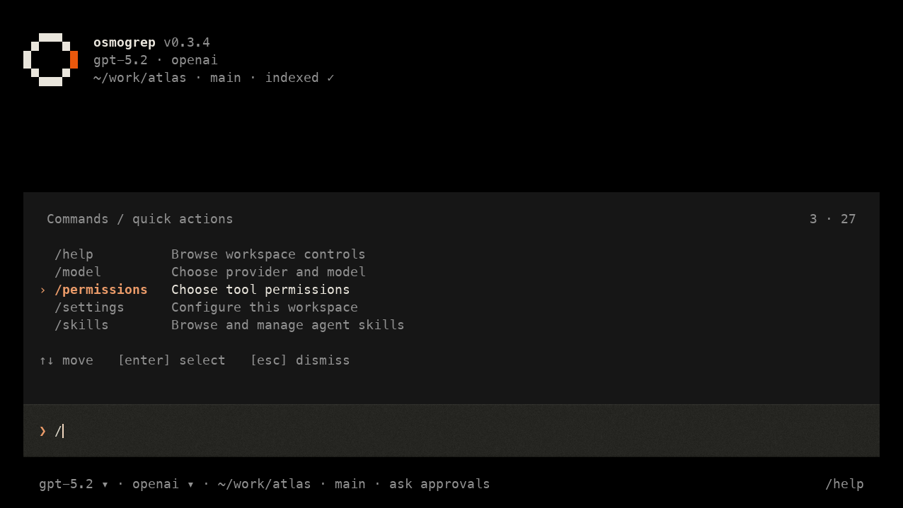
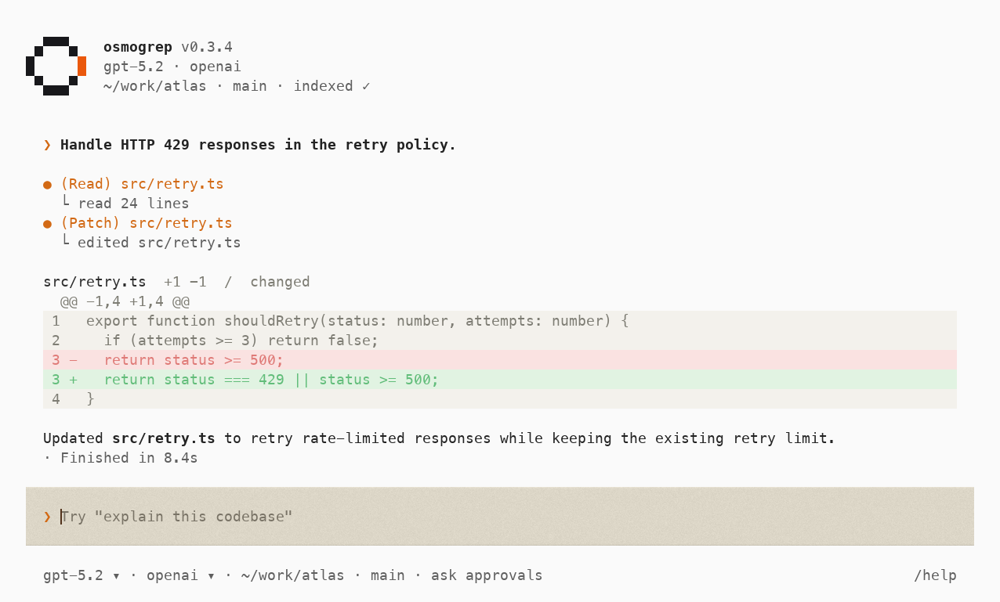
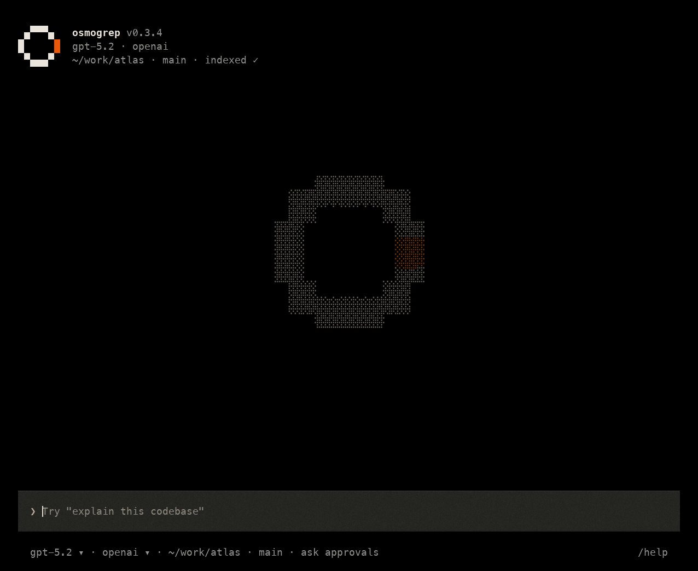
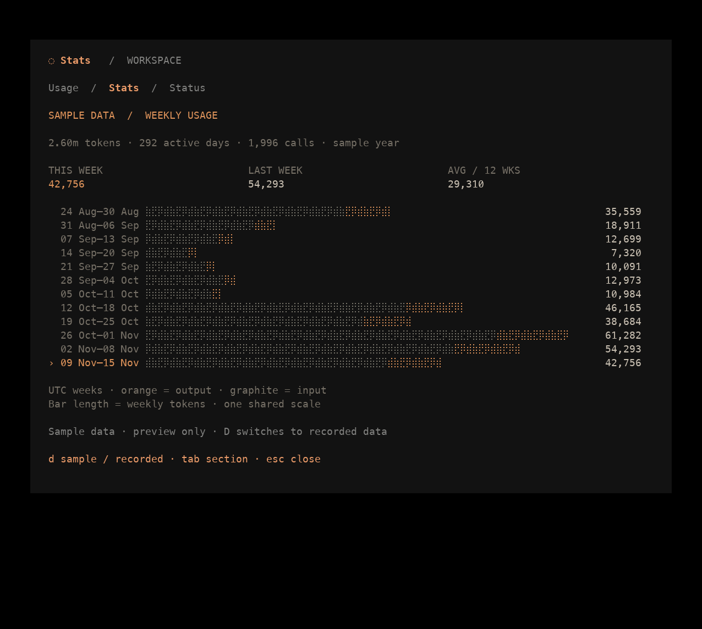

# OsmoGrep user reference

Installation, configuration, controls, and advanced usage. For the product overview, see the [README](../README.md).

## Quickstart

For the current source and terminal UI:

```sh
git clone https://github.com/kaushal07wick/OsmoGrep.git
cd OsmoGrep
cargo install --path . --locked

cd /path/to/your/project
export OPENAI_API_KEY="your-api-key"
osmogrep
```

A Rust toolchain is required to build. Install **Node.js 22.19 or newer** for the TypeScript UI; the renderer bundle is already included, so users do not need to run npm. Without Node, OsmoGrep uses its native Rust terminal interface. Linux source builds also require `pkg-config` and ALSA development headers, as configured in [CI](../.github/workflows/ci.yml).

Use `/key` inside the app to set credentials instead of an environment variable. `osmogrep doctor` reports installation and configuration details. For an existing checkout, pull the changes and repeat `cargo install --path . --locked` to update it.

The optional [installer](../install.sh) also attempts to install tmux/Neovim and initialize a managed editor configuration. The Cargo commands above install OsmoGrep itself.

Try requests such as:

```text
Explain the difference between these two functions.
Handle HTTP 429 responses in the retry policy.
Find why cancellation leaves this request running.
Review the changes in src/parser.rs.
```

## The terminal

### A composer you can keep working in

The composer has a fine paper texture: **Graphite** in dark mode and **Cotton** in light mode. Drafts grow to eight visible lines and scroll to the cursor after that. Text remains editable terminal text, including when native graphics draw the material behind it.

Typing `/` opens an attached, searchable command tray. The model and provider in the status line are selectors. `/settings`, `/permissions`, `/skills`, `/keymap`, and `/statusline` open workspace controls.



| Control | Default behavior |
| --- | --- |
| Enter | Send; during a run, queue a separate follow-up |
| Shift+Enter | Insert a newline, when supported by the terminal |
| Tab during a run | Queue the current draft |
| Arrow keys / Home / End | Edit and navigate the draft |
| Shift+arrows | Select text |
| Ctrl+A / Ctrl+C / Ctrl+X / Ctrl+V | Select all / copy / cut / paste |
| Mouse wheel / PageUp / PageDown | Scroll the transcript |
| Right-side scroll rail | Click or drag through transcript history |
| End with an empty draft | Return to live output |
| Ctrl+T | Expand or fold tool output and diffs |
| Ctrl+O | Copy the latest assistant response |
| Escape | Cancel a run or dismiss a control; keep the app open |
| `/exit` | Exit the application |

Terminal-managed copy/paste shortcuts also remain available. Key bindings can be changed through `/keymap`. After cancellation, queued turns pause; Enter with an empty draft resumes them. Use `/steer now <text>` when you explicitly want to interrupt and redirect the current run.

### Images and readable output

Drag or paste a PNG/JPEG/GIF/WebP path to attach it. On macOS, Ctrl+V can attach a copied clipboard image. Supported terminals show thumbnails; the original image bytes are delivered to the selected model. Remove an `[Image #N]` label to exclude that attachment. Image input requires a vision-capable model.

Long output stays inside a scrollable transcript. Drag over transcript text to select and copy it. Permission prompts leave recent output visible. Patch approvals show the target path, and applied diffs appear before the assistant's final summary.



### Quiet motion, useful metrics

A fresh conversation starts with a dim, fine-dot logo that rotates, morphs through one of four scenes, and settles after ten seconds. Click the settled mark to brighten and replay it. Hover does not restart it; Reduce Motion settles it immediately.

<details>
<summary>Preview a click-replay animation</summary>



</details>

Kitty-compatible graphics add fine animation pixels and paper textures. Other terminals use text/Braille artwork and matte composer colors. The dark canvas stays black.

`/stats` displays weekly token aggregates, input/output composition, and this-week/last-week totals. `/usage` shows provider-reported counts. Sample data is explicitly labeled; press **D** in Stats to switch between the sample and recorded activity. Samples are never saved as real usage or presented as billing estimates.



## Providers

Choose a provider and model through the footer selectors or `/model`. Catalog discovery uses the configured endpoint when available; custom model IDs remain supported.

| Provider | Default API | Credential environment variable |
| --- | --- | --- |
| OpenAI | Responses | `OPENAI_API_KEY` |
| Anthropic | Native Messages | `ANTHROPIC_API_KEY` |
| OpenRouter | Chat Completions | `OPENROUTER_API_KEY` |
| Groq | Chat Completions | `GROQ_API_KEY` |
| Mistral | Chat Completions | `MISTRAL_API_KEY` |
| DeepSeek | Chat Completions | `DEEPSEEK_API_KEY` |
| xAI | Chat Completions | `XAI_API_KEY` |
| Ollama | Chat Completions; localhost:11434 | Optional `OLLAMA_API_KEY` |
| LM Studio | Chat Completions; localhost:1234 | Optional `LMSTUDIO_API_KEY` |
| Custom gateway | Chat Completions by default | `OSMOGREP_API_KEY`, or configured `api_key_env` |

Interactive examples:

```text
/model openai gpt-5.2
/model anthropic <model-id>
/model ollama <installed-model-id>
/model custom <model-id> https://gateway.example/v1 --api=chat-completions
```

For a custom endpoint, set its API in Model settings or pass `--api=responses`, `--api=chat-completions`, or `--api=anthropic-messages`. `--api=auto` restores provider inference. The base URL is the API root, without the final request suffix.

Requests, streaming, images, tool calls/results, and usage are translated for the selected API. Switching providers retains separately scoped saved keys. Model capabilities still matter: an endpoint adapter does not add vision or tool support to a model that lacks it.

OAuth subscription login, native Gemini/Vertex and Bedrock transports are not included in these API-key integrations. See [provider behavior and limits](agent-provider-design.md).

## Permissions and data

Choose a profile through `/permissions`:

| Profile | Behavior |
| --- | --- |
| Read only | Mutating tools are unavailable and blocked at execution |
| Ask for approval (`workspace-auto`) | Dangerous actions such as shell commands and file edits require approval |
| Full access | Dangerous actions run without individual approval prompts |

These are application-level tool policies, not an operating-system sandbox. A shell guard blocks known destructive command patterns. `/undo` can restore the last captured agent edit; it does not reverse arbitrary shell side effects.

Prompts, relevant context, attached images, and tool results go to your selected model provider. Provider credentials stay in the Rust process and are not sent to the TypeScript renderer. Keys entered through `/key` are saved locally in configuration; they are not stored in an OS keychain. Environment variables can be used instead. Headless events mask secret-like values on a best-effort basis.

Repository indexing and run artifacts live under `.context/`:

```text
.context/
  context.json                  Code index and call graph
  osmogrep-runs/                 Tool, permission, and status events
  osmogrep-results/              Oversized tool output
  osmogrep-verification.jsonl    Command evidence and freshness
  osmogrep-plan.json             Saved plan
  osmogrep-workflows/            Explicit workflow runs
```

Sessions, preferences, saved credentials, and usage history live in the platform configuration directory: normally `~/.config/osmogrep/` on Linux, `~/Library/Application Support/osmogrep/` on macOS, and `%APPDATA%\osmogrep\` on Windows. Add `.context/` to the project's `.gitignore` if you do not want local artifacts committed.

Automatic review/test scheduling is **off by default**. A greeting or unrelated question does not resume stale work. Subagents and worktree swarms require an explicit delegation request; a tooltip is not permission to start them.

## Instructions, skills, and integrations

- **Repository instructions:** root `.osmogrep.md`, `AGENTS.md`, `CLAUDE.md`, and `.cursorrules` are loaded within a shared size budget. They guide requested work rather than create tasks of their own.
- **Skills:** browse `/skills` and invoke a selected skill with `$skill-name`. Discovery includes repository `skills/`, `.agents/skills/`, `.osmogrep/skills/`, and corresponding supported user skill directories.
- **Neovim:** `/nv [file]` opens the editor through an isolated tmux integration. Narrow terminals use full-width windows; wide terminals can split. Requires tmux and Neovim.
- **MCP and hooks:** `/mcp` inspects configured command bridges. Optional `pre_shell`, `pre_edit`, and `post_edit` hooks are configured in `config.toml`.
- **Advanced workflows:** GitHub triage, voice input, explicit worktree swarms, and bounded `ultracode` workflows remain available. They are optional and may need external services or tools.
- **Regression intelligence:** optional revision-aware indexing, context queries, and prediction are documented in [the intelligence guide](prre.md). Normal coding does not depend on that integration.

The system prompt is readable at [src/prompts/agent.md](../src/prompts/agent.md). [The provider design notes](agent-provider-design.md) explain conversation delivery, tool-result replay, cancellation, and remaining integration limits.

## Commands and headless use

Use `/help` for searchable controls. For testing, reviewing, planning, and implementation, describe the task in ordinary language; workflow slash commands are not required.

| Command | Purpose |
| --- | --- |
| `/model`, `/key`, `/permissions` | Configure the model, credentials, and tool policy |
| `/settings`, `/theme`, `/keymap`, `/statusline` | Customize the workspace |
| `/skills`, `/mcp` | Inspect available skills and connected tool bridges |
| `/stats`, `/usage`, `/status` | Inspect activity and run state |
| `/diff`, `/undo`, `/copy` | Inspect, revert, or copy session work |
| `/new`, `/clear`, `/compact`, `/rename` | Manage the conversation |
| `/steer <text>`, `/steer now <text>`, `/steer clear` | Persistent instructions or explicit live steering |
| `/jobs`, `/nv`, `/exit` | Background work, editor integration, and exit |

Run without the terminal interface:

```sh
osmogrep run \
  --repo-root /path/to/project \
  --prompt "Explain how request cancellation is handled" \
  --permission-profile read-only \
  --json-events
```

`--json-events` emits newline-delimited JSON for streaming text, tool calls/results, permissions, usage, and completion. `--prompt-file` reads a longer request from a file. Headless dangerous actions are denied unless `--auto-approve` is supplied; pick the permission profile deliberately.

Other CLI entry points include `sessions`, `doctor`, `triage`, `index`, `context`, `predict`, `intelligence-mcp`, and `uninstall`. Run `osmogrep <command> --help` for their arguments.

Important environment overrides:

| Variable | Purpose |
| --- | --- |
| `OSMOGREP_PROVIDER`, `OSMOGREP_MODEL`, `OSMOGREP_BASE_URL`, `OSMOGREP_API` | Provider, model, API root, and wire format |
| `OSMOGREP_REASONING_EFFORT` | Reasoning effort for supported models |
| `OSMOGREP_MAX_ITERATIONS` | Per-run model/tool loop limit |
| `OSMOGREP_NO_STREAM` | Request non-streaming responses |
| `OSMOGREP_MOUSE` | Mouse reporting; `off` leaves keyboard navigation available |
| `OSMOGREP_UI=native` | Select the native Rust interface |
| `OSMOGREP_DISABLE_UPDATE_CHECK` | Disable the startup update check |

## Development

```sh
npm --prefix terminal-ui ci
npm --prefix terminal-ui test
npm --prefix terminal-ui run build
cargo test --locked
cargo run --locked
```

Commit the generated `terminal-ui/bundle/renderer.mjs` alongside renderer changes. CI checks bundle reproducibility and runs Rust checks on Linux, macOS, and Windows. Full terminal/clipboard/editor acceptance is currently exercised on macOS.

| Path | Responsibility |
| --- | --- |
| `src/agent.rs`, `src/provider.rs` | Conversation/tool loop and provider APIs |
| `src/prompts/agent.md` | Base agent behavior |
| `src/tools/` | Tool implementations and registry |
| `src/ui/`, `terminal-ui/src/` | Rust editor/event bridge, TypeScript presentation, native fallback |
| `src/verification.rs`, `src/tool_guard.rs`, `src/shell_guard.rs` | Evidence, repeated-call guard, and shell policy |
| `src/context/`, `src/intelligence/` | Code indexing and optional regression intelligence |
| `terminal-ui/scripts/` | Terminal acceptance and documentation preview tools |

See the [terminal development guide](../terminal-ui/README.md), [workspace behavior](terminal-workspace.md), and [validation manifest](terminal-ui-validation.json). Live-provider scripts make opt-in API calls; local protocol fixtures are separate from live checks. README previews can be regenerated with `python3 terminal-ui/scripts/readme-previews.py` using Node, Pillow, and Menlo or DejaVu Sans Mono.

## Contributing

Issues and pull requests are welcome. Keep changes focused, include a meaningful check for new non-trivial behavior, and describe the result and any remaining limitations.

## License

[MIT](../LICENSE). Created by [Kaushal Choudhary](https://github.com/kaushal07wick).
