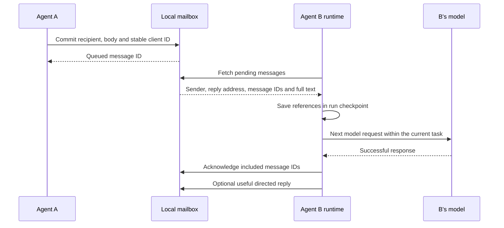

# Local session messaging

OsmoGrep uses a durable SQLite mailbox shared by its local processes. It does not use ZeroMQ, NATS, a remote broker, or Markdown mailbox files.

## Identity and routing

Sessions have stable UUIDs, separate running-instance IDs, names and Agent A/B labels. A canonical repository identity groups linked worktrees; file claims stay specific to the actual checkout. Labels are allocated transactionally and can be reused after an instance closes. UUIDs remain the routing authority.

The model receives its own identity, live peers, previous contact and latest sender. The prompt limits the peer list to sixteen entries; `team peers` refreshes discovery. A clear target sends directly by UUID, label or unique name. Ambiguous names need a choice. Closed sessions reject new sends rather than starting an old conversation.

After a directed exchange, short follow-ups can continue with that recipient without requiring a magic phrase. Negative instructions still block sends. Read-only questions do not authorize sends. New recipients and broadcasts need their own authorization. Natural-language routing hints live separately in `src/team/policy.rs`; transport identity and project checks remain in the store.

## Delivery lifecycle

A queued result means the message is durably stored. A receipt means explicit review or successful model consumption, not completed work. Provider failure or cancellation before a response leaves automatic acknowledgement pending. The message remains available for a later turn.

A unique `(sender, client ID)` constraint deduplicates identical retries. Reusing that ID with a different recipient or body fails. Message markers prevent inserting the same reference twice into one conversation. These guarantees do not imply exactly-once model execution across network failures or crashes.

Bodies are stored verbatim. An oversized message is rejected with a size error, never silently shortened. UI folding does not modify stored text. History uses bounded pages and batched receipt lookup; older pages remain accessible. Clearing chat logs does not delete the mailbox.

## Context and permissions

Messages identify their sender and reply address and are marked as collaborator reference data. Relevant findings can change how the model approaches the existing task. They cannot approve tools, relax permissions, spawn agents or authorize unrelated work. File claims and stale-content checks still apply to edits.

Working agents consume messages at model boundaries, preserving half-executed edits and permission decisions. Open idle sessions receive and display messages but wait for their next turn before calling a model. Automatic idle wake-up is not implemented; it needs explicit request/reply correlation and a bounded reply budget before it can avoid reply loops reliably.

## Presentation and latency

The newest message appears above the composer for seven seconds. It shows the agent/session name, time and a short body, with Show more for larger messages. There is no permanent Team counter. The draft stays intact. Expired notices are not reprinted into normal chat.

Team holds the durable archive. Show more opens the complete message; Show less returns to the list. Older messages loads earlier pages. A separate peer log kind prevents ordinary model text from impersonating a notification.

Large normal responses, tool results and diffs also have visible Show more/Show less actions. Expanding a diff requests its full rendered contents; addition/removal totals describe the complete change while folded.

The store commits without waiting for either model. Discovery and presentation poll at 250 ms. This is a polling interval, not a guaranteed response time: the renderer can block the input thread and model calls have their own latency.

A future optimization can notify recipients through private per-session Unix sockets on macOS/Linux and named pipes on Windows. SQLite should remain authoritative; notification delivery is only a wake-up hint, and reconnects must drain pending messages. That notification path is not implemented yet.

## Research sources

| Source | Useful pattern | OsmoGrep decision |
| --- | --- | --- |
| [Claude cross-session messaging](https://code.claude.com/docs/en/cross-session-messaging) | Live discovery, local inbox sockets, sender/reply identity, delivery boundaries | Adopt routing and reference-data boundaries; retain SQLite polling for now |
| [MCP Agent Mail, Rust](https://github.com/Dicklesworthstone/mcp_agent_mail_rust) | Named identities, inbox/history, receipts and file reservations | Use these concepts inside the harness without adding its server or Git archive |
| [AutoGen runtime](https://github.com/microsoft/autogen/blob/main/python/packages/autogen-core/src/autogen_core/_single_threaded_agent_runtime.py) | Explicit sender/recipient/message IDs and delivery stages | Keep transport records separate from model instructions and notifications |
| [NATS request/reply](https://docs.nats.io/concepts/request-reply) | Reply addressing and bounded request/reply lifetimes | Useful for future correlated idle replies; no NATS service is introduced |
| [ZeroMQ routing](https://zguide.zeromq.org/docs/chapter3/) | Explicit routing identities and asynchronous local delivery | Inspiration for notification transport, not a replacement for durable storage |

Validation uses independent harness processes and a local fixture provider. It covers natural-language follow-ups, live targeting, idempotent retries, pending receipts during provider calls, history pagination, reference delivery and project isolation. It does not establish real-model language quality, unlimited peer scale or multi-hour recovery performance.
