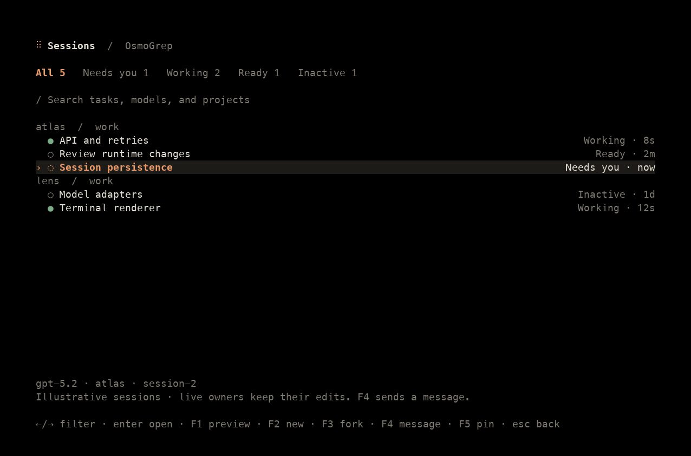

# Sessions and teams

OsmoGrep instances coordinate through a private local SQLite database. Each has a stable session ID and records its project, current task, provider/model, status, and recent activity.

Open two terminals in the same repository with `osmogrep --new`, then ask naturally:

> Talk to the other agent and ask what it is working on.

> Ask the agent handling retries whether its changes affect the API.

The coding agent discovers matching sessions, selects the target by its metadata, and sends the message. It asks for clarification when the target is ambiguous. You do not need a slash command or a manual messaging toggle. Each instance keeps its own task, context, permissions, and process ownership; messaging does not authorize spawning more agents or expanding another agent’s task.

## Session center

Press **⌘←** (or **Ctrl+S**) (or run `osmogrep agents` from your shell). Search titles, directories, models, and session IDs. Sessions are ordered by recent activity and show their project, with filters for working, ready, inactive, and needs-you states. Errors appear under Needs you. Elapsed update age reflects actual activity rather than heartbeat traffic.

| Control | Action |
| --- | --- |
| Left/right | Change status filter |
| Up/down | Select a session |
| Enter | Resume an inactive session; preview a live owner's saved output |
| F1 | Preview saved output without taking ownership |
| Ctrl+N | New session in the selected project's directory |
| F3 | Fork the selected session's saved history |
| F4 | Send a message to the selected session in this repository |
| F5 | Pin/unpin a session within its project |
| Escape | Back to the list, or back to your unchanged composer |

Previews refresh once a second; Up/down, PageUp/PageDown, Home/End scroll saved output. They are saved snapshots, not terminal screen scraping. A running process keeps its exclusive session writer lock. Finish foreground/background work and close the editor before switching your own session. A fork receives saved conversation history, not another process's unfinished command handles.

## Messages and shared progress

The Team view shows unread messages and recorded progress. The composer shows a Team capsule when enabled or when messages are waiting. Click it to open the view.

Ask for unread messages, a teammate’s status, or a specific update in ordinary language. The Team view also provides Inbox, Message history, and Shared activity controls. The session center’s F4 shortcut can send a message directly to a selected session.

The agent's `team` tool supports peers, inbox, history, updates, send, acknowledge, claim, and release. Sends use a stable client message ID, so retrying a send does not duplicate it. Broadcasts reach sessions already registered when sent; direct messages survive an offline recipient's restart. Acknowledgement means accepted into durable context or explicitly reviewed, not a guarantee that the model acted on it. The sender's UI tracks the latest outgoing acknowledgement.

During an active task, incoming messages are added at a completed tool boundary before the next model request. They are clearly marked collaborator reference data; they cannot replace the user's objective, grant tool approval, or authorize delegation. An idle instance shows an unread indicator until the user starts work or reads its inbox. Messages never silently create a paid turn.

Status and completed file-tool edits are recorded automatically. Raw shell arguments, provider credentials, and full tool output are not broadcast into the shared activity feed. Message bodies are visible to collaborating sessions and may reach their selected model providers.

## Coordinated edits

Agents can claim exact file paths for up to two minutes. Active task heartbeats renew explicit claims; completion releases them. File mutation tools also acquire short atomic claims, refusing a conflicting owner before changing files. Multi-file claims succeed together or leave no partial claim. Existing read-before-write and stale-content checks still apply.

Claims are cooperative guards for OsmoGrep file tools. Arbitrary shell commands, MCP servers, and outside editors do not obey these leases. Use separate Git worktrees for strongly isolated concurrent edits. Linked worktrees share messages through their common Git directory while their file claims stay scoped to each actual checkout.

## Storage and failure behavior

The database is `team.sqlite3` in the platform OsmoGrep configuration directory. It uses transactions, write-ahead logging, private Unix file permissions, and bounded queries/message sizes. Nothing requires a manually maintained repository Markdown file. Live presence expires eight seconds after a process stops heartbeating. Graceful exit closes presence and releases claims; expired leases recover after a crash.

This is coordination between processes on one machine/user account. It does not provide remote network messaging, distributed consensus, or automatic takeover of another session. SQLite can report contention or storage failures; sends then remain visibly failed and drafts stay editable. Session snapshots and messages can contain private project information and should be protected with the rest of your local configuration.

## Runtime presentation

A cached fine-dot sphere replaces the previous working wave. Labels distinguish thinking, reading, commands, edits, and waiting for permission; the timer reports elapsed wall time. Reduce Motion keeps the visual still. Kitty-compatible terminals use a 36px graphic; other terminals use a small Braille fallback. Completion timing sits on its own aligned line.

The composer voice capsule appears only while voice is connecting or active, and reflects its actual connection state. It does not simulate microphone levels. Entering an API key pauses voice, and late transcripts cannot enter a protected input field.

The implementation uses the existing Rust runtime and pi-tui renderer. References included local Codex session discovery/overview behavior and the [TermUI component catalog](https://www.termui.io/components); no UI framework replacement was required.

### Settings and release notices

`/settings` opens eight visible categories. Choose one with Up/Down and Enter, or click it. Escape returns to the categories before closing; the composer draft stays intact. Direct shortcuts such as `/model` and `/permissions` still open their controls.

OsmoGrep checks GitHub releases at launch and every six hours. A release card appears when the agent is idle and the composer is empty, with short release highlights and three choices: **Update now**, **Later** (next launch), and **Skip this version** (remembered across launches; a newer version can still appear). Later is selected by default. Downloads use the existing checksum verification and binary replacement; the current session continues until you restart. `OSMOGREP_DISABLE_UPDATE_CHECK=1` disables the finder.

Ordinary edits retain numbered red/green diffs without a blanket stale-verification warning. Explicit verification and recorded command results remain available. The working orb retains its previous appearance and motion.

Usage opens a compact provider-reported token summary with an input/output bar, cached-input reuse, call count and provider wait. Context remains an explicitly labeled estimate, without invented account limits or pricing. Weekly history is available in Stats.

Fenced code uses a separate highlighted surface with a **Copy** button. Clicking it copies the block contents without Markdown fences or display colors; **Copied** confirms success. Copy targets scroll with the block and remain separate from the composer. Completed turns leave one blank row before the input surface.

### Fresh sessions and the editor workspace

A normal launch starts a fresh conversation. Workspace theme, density, appearance preferences and key bindings carry over; the selected permission profile also stays in effect. Previous prompts, output, queued work, one-off approvals and jobs do not carry over. Saved conversations remain available in the session center. `--resume` and `--fork` still select an explicit saved thread.

`/nv [file]` opens a black Neovim editor beside the agent at 96 columns and wider. The editor has an OsmoGrep status line and file browser, without loading your personal Neovim plugins or welcome screen. Your normal Neovim configuration is not changed. In a managed workspace, Alt+Left/Right or a mouse click switches panes; in Neovim, Escape then Space a returns to chat and Space e browses files. `:q` closes the editor and expands the agent. Smaller terminals retain separate full-width windows. Moving a standalone agent into this workspace explicitly resumes its current session after releasing the previous writer lock.

On macOS, ⌘← requires the terminal to forward the Command modifier. Ghostty defaults convert it to Ctrl+A; Ctrl+S opens sessions without changing your terminal configuration.
